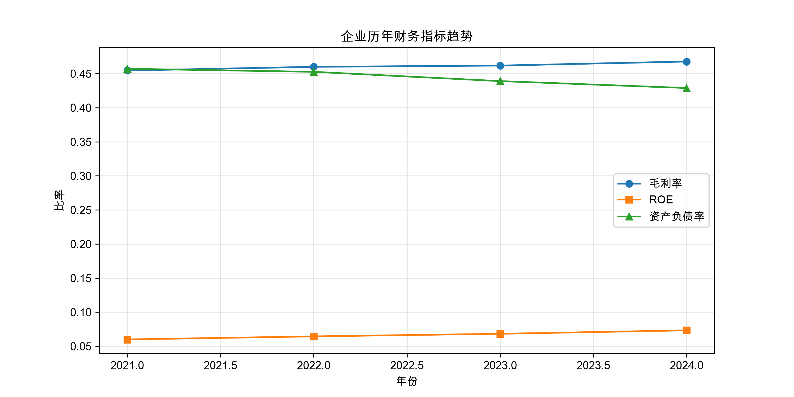

# Corporate Financial Ratio Analysis
## 📌 Project Overview
This project uses Python to read simulated public financial statement data, automatically calculate core financial metrics including gross margin, ROE and debt-to-asset ratio, and generate visual charts for fundamental analysis.

## 📖 Background
Financial ratios are the foundation of corporate fundamental analysis for investment banking. Manual calculation of financial indicators is repetitive and error-prone. This project helps me combine accounting knowledge from my business course with Python data skills to build a lightweight financial analysis tool.

## 🧰 Tools & Stack
- Python: NumPy, Pandas, Matplotlib
- Git & GitHub
- VS Code
- Data source: Simulated financial CSV data

## 📊 Dataset
- Data source: Self-built simulated financial data
- Time range: 2021–2024
- Fields: Revenue, Cost of Sales, Net Profit, Total Assets, Total Liabilities

## 📈 Methodology
1. Data cleaning and validation
2. Calculate core financial ratios by accounting formulas
3. Visualize historical trends with Matplotlib
4. Analyze profitability and solvency changes

## ✅ Results & Conclusion
- Automatically computed gross margin, ROE and debt-to-asset ratio
- Visual trend chart showing changes in financial performance
- Limitations: Using simulated data for practice; macro factors and industry benchmarks are not included. I will iterate this project with real listed company data later.



## 📝 How to Run
```bash
git clone https://github.com/Raphaelasterling/git-demo.git
cd git-demo
pip install numpy pandas matplotlib
python3 financial_analysis.py
